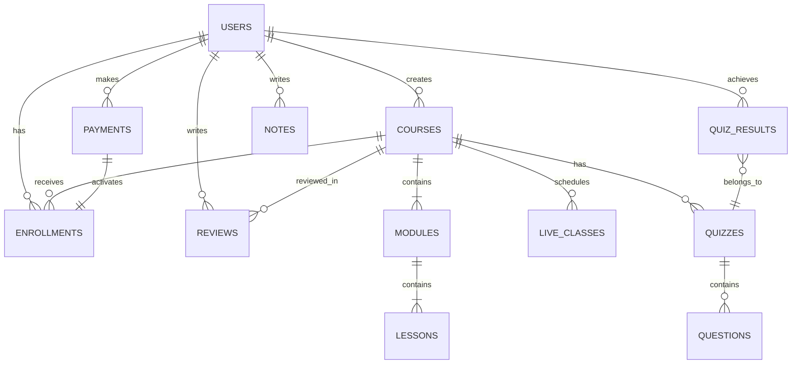

# ShikhoBD Database Schema

This document outlines the database architecture for the ShikhoBD learning management platform. The schema is designed for a relational database (e.g., PostgreSQL/MySQL) to ensure data integrity and complex relationship management.

## 1. Entity-Relationship Diagram

---

## 2. Table Definitions

### A. Core Management
| Table | Description | Key Fields |
| :--- | :--- | :--- |
| **Users** | Platform participants | `id`, `name`, `email`, `password_hash`, `role` (STUDENT, INSTRUCTOR, ADMIN), `avatar_url` |
| **Courses** | Learning content | `id`, `title`, `slug`, `description`, `price`, `discount_price`, `instructor_id`, `category`, `thumbnail_url`, `status` (DRAFT, PUBLISHED) |
| **Categories** | Content grouping | `id`, `name`, `icon` |

### B. Curriculum & Content
| Table | Description | Key Fields |
| :--- | :--- | :--- |
| **Modules** | Course sections | `id`, `course_id`, `title`, `order_index` |
| **Lessons** | Individual video/text content | `id`, `module_id`, `title`, `content_type` (VIDEO, TEXT), `video_url`, `duration`, `is_free`, `order_index` |
| **Resources** | Downloadable files | `id`, `lesson_id`, `file_name`, `file_url`, `file_type` |

### C. Learning & Engagement
| Table | Description | Key Fields |
| :--- | :--- | :--- |
| **Enrollments** | User-Course mapping | `id`, `user_id`, `course_id`, `progress_percent`, `enrolled_at`, `is_completed` |
| **Lesson_Progress** | Individual lesson tracking | `id`, `user_id`, `lesson_id`, `is_completed`, `last_watched_time` |
| **Notes** | User lesson notes | `id`, `user_id`, `lesson_id`, `content`, `timestamp_in_video` |
| **Reviews** | Course feedback | `id`, `user_id`, `course_id`, `rating` (1-5), `comment`, `created_at` |

### D. Assessment & LIVE
| Table | Description | Key Fields |
| :--- | :--- | :--- |
| **Quizzes** | Course assessments | `id`, `course_id`, `title`, `passing_score` |
| **Questions** | MCQ items | `id`, `quiz_id`, `question_text`, `options` (JSON), `correct_answer` |
| **Quiz_Results** | Student attempts | `id`, `user_id`, `quiz_id`, `score`, `attempted_at` |
| **Live_Classes** | Scheduled sessions | `id`, `course_id`, `instructor_id`, `title`, `meeting_link`, `scheduled_at`, `duration` |

### E. Financials
| Table | Description | Key Fields |
| :--- | :--- | :--- |
| **Payments** | Transactions | `id`, `user_id`, `course_id`, `transaction_id`, `amount`, `payment_method`, `status` (PENDING, SUCCESS, FAILED), `created_at` |

---

## 3. Indexing Strategy

To ensure high performance as the student base grows, the following indexes are recommended:

1.  **Users**: Unique index on `email`.
2.  **Courses**: B-tree index on `slug` (for fast lookups) and `instructor_id`.
3.  **Enrollments**: Composite index on `(user_id, course_id)` to quickly check if a student has access.
4.  **Lesson_Progress**: Composite index on `(user_id, lesson_id)` for tracking.
5.  **Payments**: Index on `transaction_id` and `user_id`.
6.  **Search**: Full-text search index on Course `title` and `description`.

---

## 4. Scalability Considerations

-   **Video Content**: Video URLs should point to a CDN (e.g., AWS S3 + CloudFront) or a specialized video host (e.g., Mux, Vimeo).
-   **Analytics**: For heavy reporting (Instructor/Admin dashboards), consider a read-replica database or a separate OLAP store if data volume exceeds 10M+ rows.
-   **File Storage**: Use JSONB columns for flexible data like Quiz options or Lesson metadata.
